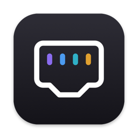
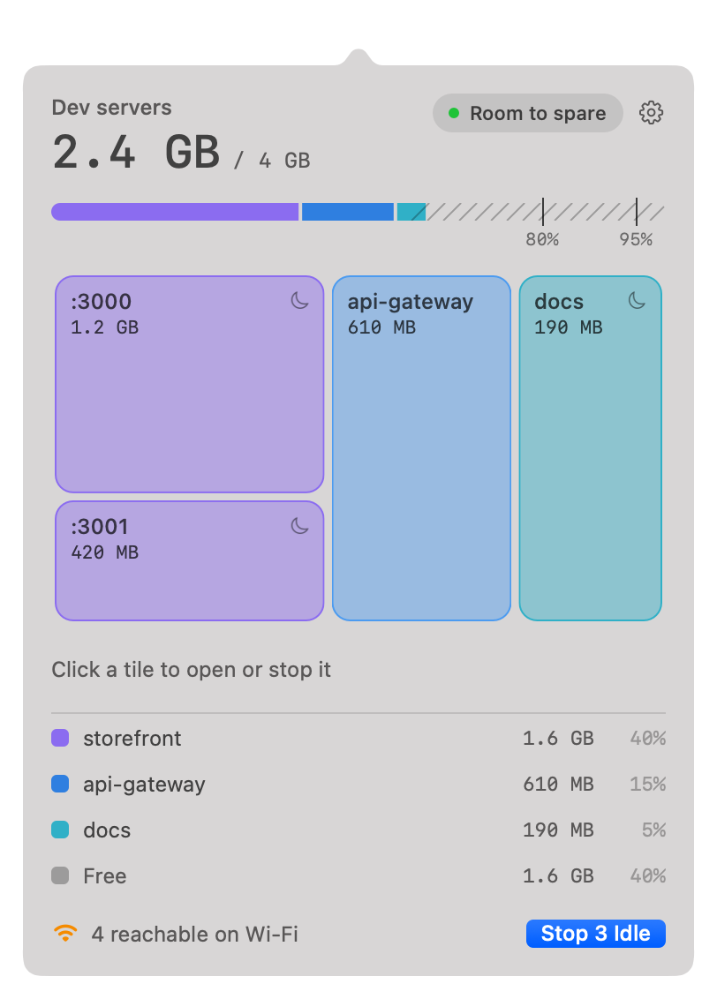
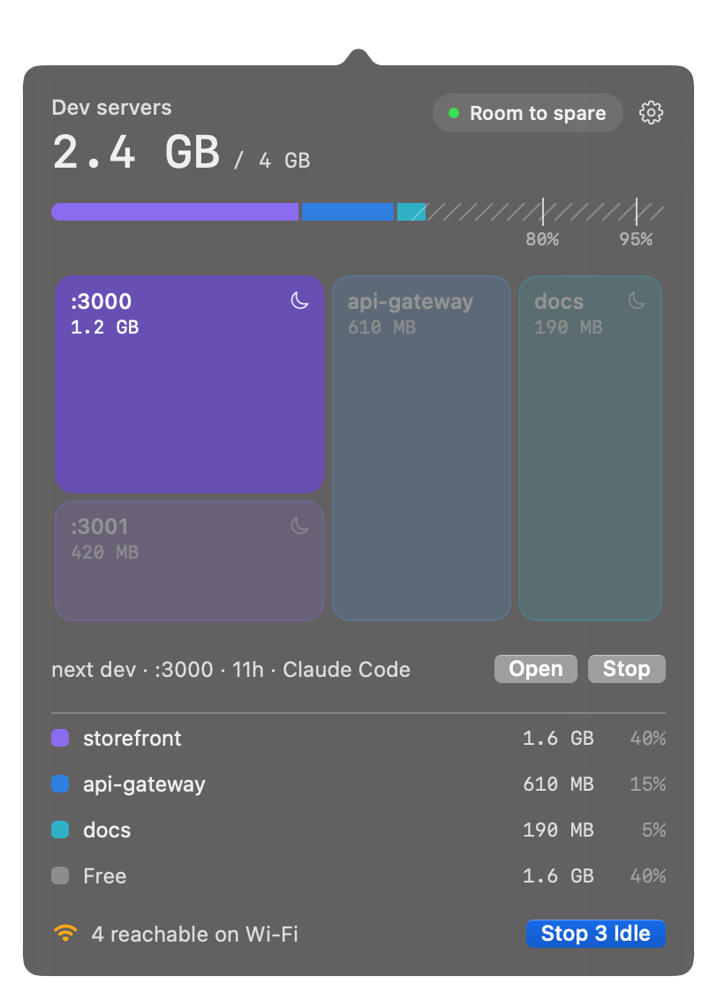

<p align="center">
  
</p>

<h1 align="center">Ports</h1>

<p align="center">
  <strong>See which dev servers are running on your Mac, and what they cost you.</strong><br>
  A tiny native menu bar app and terminal command for the servers you forgot about, or never knew an AI coding agent started.
</p>

<p align="center">
  <a href="https://github.com/Open-Dev-Society/ports/releases/latest"></a>
  <a href="https://github.com/Open-Dev-Society/ports/actions/workflows/ci.yml"></a>
  
  
  <a href="LICENSE"></a>
</p>

<p align="center">
  <a href="https://github.com/Open-Dev-Society/ports/releases/latest"><strong>Download for Mac</strong></a>
  ·
  <a href="#use-it-from-the-terminal">Terminal command</a>
  ·
  <a href="CONTRIBUTING.md">Contribute</a>
</p>

<p align="center">
  
  
</p>
<p align="center"><sub>Screenshots use example servers.</sub></p>

## Why

AI coding agents start servers for you, and those servers keep running. Nobody stops them, because often nobody knows they're there. On the Mac where this project began, five forgotten servers held 4.6 GB, one `next dev` alone at 3.8 GB after 11 hours, and all five were open to the local network.

Existing tools answer "what's on this port?". Ports answers "what's running that I forgot about, and what is it costing me?", in a place you can see it without opening a terminal.

## Features

- **Memory in your menu bar.** A port icon and how much memory your dev servers use, refreshed every 30 seconds.
- **Real memory figures.** Uses the same number as Activity Monitor. Plain RSS can read 11 MB for a server really using 3.7 GB, because most of it is swapped out.
- **See what matters at a glance.** One tile per server, sized by memory and grouped by project, against a budget you can change.
- **Only your dev servers.** Spotify, AirPlay and other apps or system services stay hidden.
- **Who started it.** Shows when Claude Code or a terminal such as iTerm or VS Code started a server, when it can tell, and traces agent worktrees back to their project.
- **Open to the network?** Flags servers that others on your Wi-Fi may be able to reach.
- **Stop the whole server.** Signals the process group, so `pnpm` or `next dev` can't bring it straight back.
- **Stop every idle server at once**, with five seconds to undo.
- **Small.** About 12 MB in the background. [See how](#how-it-stays-small).
- **Private.** No account, no analytics, no network requests.

## Install

1. Download `Ports-<version>.dmg` from the [latest release](https://github.com/Open-Dev-Society/ports/releases/latest).
2. Open it and drag **Ports** to **Applications**.
3. Open Ports from Applications. The first time, its panel opens by itself under the menu bar icon with a short welcome.

> [!IMPORTANT]
> **macOS will warn you the first time.** Ports isn't notarized by Apple yet ([tracked here](https://github.com/Open-Dev-Society/ports/issues/1)), so macOS says it can't verify the app. To open it anyway: try opening Ports, then go to **System Settings → Privacy & Security** and choose **Open Anyway**. Prefer not to? [Build it from source](#build-from-source) instead.

**Ports starts at login by default.** Run from Applications, it turns on Open at Login the first time, and macOS shows its usual notice. Turn it off from the gear in the panel and it stays off.

Requires macOS 13 or later on Apple silicon or Intel. Liquid Glass appears on macOS 26 and later. So far it has mainly been run on macOS 27, so [please report](https://github.com/Open-Dev-Society/ports/issues/new/choose) anything that looks wrong on older versions.

## How to use it

Click the port icon in the menu bar.

| In the panel | What it does |
| --- | --- |
| **Tile** | Click to select a server, then **Open** it in your browser or **Stop** it, with a confirmation. Right-click to show its folder in Finder. |
| **Moon icon** | Idle: up for at least three hours with nothing connected. An open browser tab counts as connected. |
| **Stop Idle** | Stops every idle server straight away, without confirming. |
| **Undo** | Appears for five seconds after a stop and starts those servers again. Closing the panel makes the stop final. |
| **Gear** | Open at Login, Memory Budget and Quit. |

The budget is a guide you choose. It starts at a quarter of your Mac's memory, and nothing is stopped when you go over it.

> [!NOTE]
> **If a stopped server comes back,** something started it again. Coding agents are often told when a server they started exits, and may restart it because they assume it crashed. Tell the agent you don't need the server, or close its session, then stop it again.

## Use it from the terminal

The command ships inside the app. To put it on your path:

```sh
sudo mkdir -p /usr/local/bin
sudo ln -s /Applications/Ports.app/Contents/MacOS/ports /usr/local/bin/ports
```

```text
ports                  list dev servers
ports --all            include apps and system services
ports stop PORT...     stop the servers on these ports (asks first)
ports stop PORT... -y  stop without asking
ports --version        show the version
```

```console
$ ports
2 dev servers · 1.8 GB

1.2 GB   storefront  next dev  :3000  up 11h  open to network, idle
         ~/work/storefront · Claude Code
610 MB   api-gateway  uvicorn  :8000  up 2h  open to network
         ~/work/api-gateway · VS Code

6 other listening, hidden. See them with: ports --all
Stop one with: ports stop 3000
```

## Safety and privacy

- By default, Ports lists only your own processes running from your home folder. `ports --all` shows everything that's listening, and Ports still won't stop anything but a dev server.
- It refuses a server that shares a process group with a coding agent, or with Ports itself, because stopping it would take those down too.
- It scans again just before stopping, so an old list can't signal a process that has since been replaced.
- To make Undo work, the panel holds a stopped server's command, folder and environment, which can include API keys, in memory for five seconds. None of it is written to disk.
- The only settings saved are your budget and whether Open at Login has been set up.

To report a vulnerability, see [SECURITY.md](SECURITY.md).

## How it stays small

Measured with `phys_footprint`, the number Activity Monitor shows, on macOS 27.

| Approach | Memory |
| --- | --- |
| SwiftUI menu bar app, idle | 17 MB |
| AppKit, popover in the same process, after one opening | 22 MB, for good |
| **Ports: menu bar agent, idle** | **about 12 MB** |
| Ports: panel, only while open | about 20 MB more, all returned on close |
| Bare `NSStatusItem` showing text and no icon, the floor we found | 10.6 MB |
| Apple's `TextInputMenuAgent`, for comparison | 16.9 MB |

So Ports is three small programs:

```text
PortsApp     the menu bar item. Always running, links only AppKit.
PortsPanel   the panel. Runs while it's open, then exits and gives its memory back.
ports        does each scan and exits. Also the terminal command.
```

The Liquid Glass comes from Apple's own `NSPopover` and standard controls, so the app draws no glass of its own.

## Build from source

Needs macOS 13 or later and Xcode.

```sh
git clone https://github.com/Open-Dev-Society/ports.git
cd ports
./build-app.sh        # builds dist/Ports.app
open dist/Ports.app
swift test            # also starts and stops its own throwaway servers
```

`scripts/package.sh` makes the disk image and zip for a release.

```text
Sources/PortsCore    scanning, stopping, restarting, treemap layout. Shared, and where the tests point.
Sources/PortsApp     the menu bar agent
Sources/PortsPanel   the panel
Sources/ports        the terminal command
```

## Contributing

Issues and pull requests are welcome. Start with [CONTRIBUTING.md](CONTRIBUTING.md), or see [what's planned](https://github.com/Open-Dev-Society/ports/issues).

## License

[AGPL-3.0](LICENSE). Part of [Open Dev Society](https://github.com/Open-Dev-Society).
